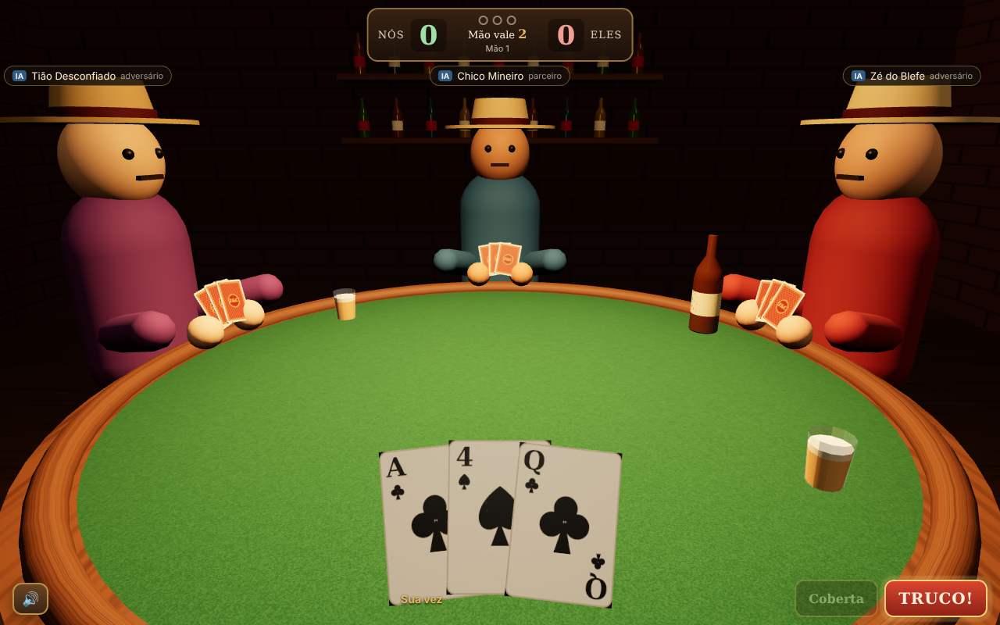

# Zap & Copeta — Truco Mineiro 3D

MVP jogável no navegador de Truco Mineiro (Manilha Velha) em 3D. Modo solo: você + 1 parceiro IA contra 2 IAs.



## Rodar

Requer Node 20+.

```bash
npm install
npm run dev        # abre em http://localhost:5173
```

Outros comandos:

```bash
npm test           # motor de regras, sinais e simulações bot vs bot
npm run typecheck  # TypeScript em todos os pacotes
npm run build      # build de produção em apps/client/dist
node scripts/e2e.cjs http://localhost:5173/   # joga uma partida inteira no Chromium (Playwright) e salva screenshots
```

`?q=low` na URL força qualidade baixa (sem sombras, resolução 1x). É ativado automaticamente quando o navegador não tem GPU.

## Deploy na Vercel

O jogo é estático (Vite), então roda no plano gratuito. As configurações de build já estão em `vercel.json`.

1. Na Vercel: **Add New… → Project** e importe `wisleyaguiar/truco-mineiro` do GitHub.
2. **Root Directory**: deixe a raiz (`./`), não aponte para `apps/client`.
3. Não precisa mexer em Framework, Build, Output nem variáveis de ambiente. Clique em **Deploy**.

Cada push no `main` publica automaticamente, e cada PR ganha uma URL de preview.

## Estrutura

```
packages/engine   Regras puras em TypeScript, sem dependências. Pronto para rodar num servidor autoritativo.
packages/bots     IA heurística com 3 personalidades + regras dos sinais secretos (olhar, interceptação, memória).
apps/client       Vite + Three.js + GSAP. Cena 3D, HUD em DOM/CSS, sons sintetizados.
docs/             PRD original + decisões de regra.
scripts/e2e.cjs   Teste ponta a ponta no navegador.
```

### Motor de regras (`@truco/engine`)

- `createMatch(config, seed)` cria a partida e distribui a 1ª mão.
- `applyAction(state, seat, action)` valida a intenção e devolve `{ state, events }` (nunca altera o estado recebido).
- `getPlayerView(state, seat)` devolve só o que aquele jogador pode ver (anti-trapaça). É o que os bots recebem.
- `getLegalActions(state, seat)`, `seatsToAct(state)`, `startNextHand(state)`.

O cliente só conversa com o motor por essas funções. Para o modo online, basta mover o motor para o servidor (Colyseus/Socket.io) e trocar as chamadas locais por mensagens.

## Controles

- Clique na carta para jogar. Botão direito (ou o botão **Coberta**) joga virada, a partir da 2ª rodada.
- **TRUCO!** (atalho `T`) pede truco. O botão vira SEIS / DEZ / DOZE conforme a mão sobe.
- `C` liga/desliga a carta coberta.
- **Sinais** (ou teclas `1`–`6`): sinal secreto pro parceiro. Se o 👁 do adversário estiver aceso, ele está te olhando e pega o sinal.

## O que ainda está fora

Online/multiplayer, vozes gravadas, ranking, duplas e campeonatos. Veja `docs/DECISOES.md`.
